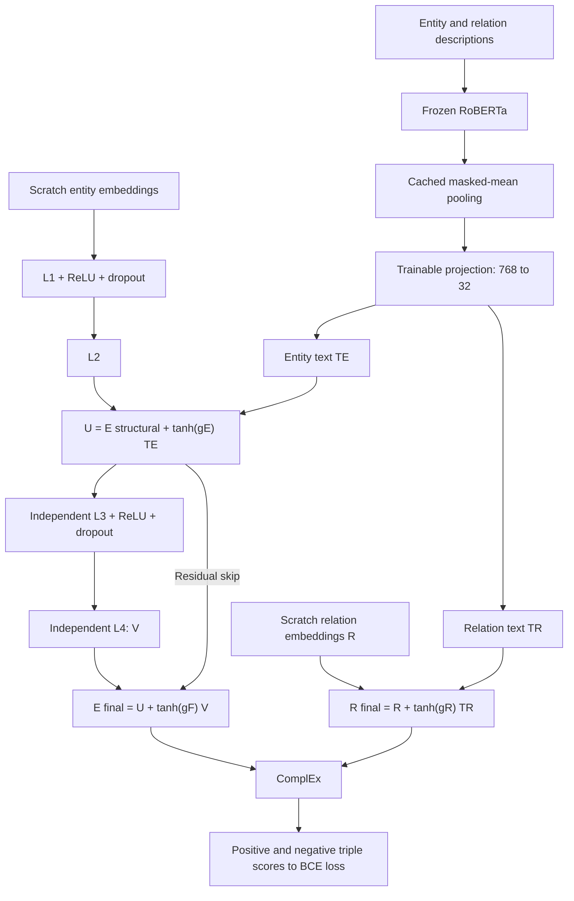
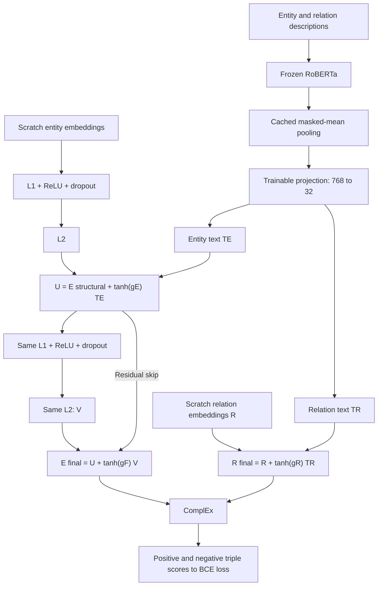
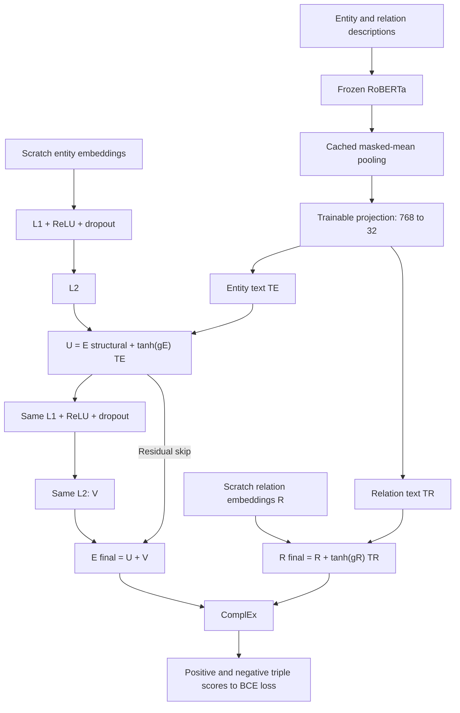

# Final full-dataset residual versus Shared C study

The requested architectures match the existing implementations at inspected
revision `72eb34630b3d7cd515a49f2e5a926fa5271b9350`. No model equations, parameter
names, shapes or initialization order were changed. The new study reuses
`KGTextRefinement`, `SharedStructuralRGAT`, `SharedRGATRefinement` and the common
`run_experiment` training/resume/evaluation loop.

## Architecture verification

| Configuration ID | Structural path | Refinement path | Unique RGAT layers | Integrated executions | Final entities |
| --- | --- | --- | ---: | ---: | --- |
| residual-no-softprompt-warmup | L1, L2 | independent L3, L4 | 4 | 4 | U + tanh(gF) V |
| shared-c-gated | L1, L2 | same L1, same L2 | 2 | 4 | U + tanh(gF) V |
| shared-c-ungated | L1, L2 | same L1, same L2 | 2 | 4 | U + V |

Every L1 block has ReLU and dropout; L2 has no added activation. Repeated calls
share actual parameter objects and draw fresh dropout masks during training.
Shared gradients accumulate from both passes into parameters registered once in
Adam. Ungated removes only the final refinement scalar, retaining the skip and
both trainable text gates. All raw gates start at .01; gated coefficients use tanh.

Text is a parallel, independent branch: descriptions -> frozen RoBERTa -> masked
mean pooling -> trainable 768-to-32 Linear/LayerNorm/GELU/Dropout projection.
Only frozen pooled vectors are cached. There are no KG-conditioned soft prompts.
Entities: U = E_structural + tanh(gE) TE. Relations: R_final = R + tanh(gR) TR.
Relations do not pass through the entity refiner. ComplEx scores final entities
and relations with the existing positive/negative BCE objective.

Warmup runs the structural two-layer encoder and ComplEx only. All modules are
initialized before warmup. The model and Adam state continue through epoch 10;
no parameter transfer or reset occurs. Shared C's refinement weights have been
trained during warmup because they are structural weights; the independent
refiner has not. This is an intrinsic architectural difference. Shared C gated
and ungated have identical common initial parameters; ungated has one fewer scalar.
Structural and text-projection fingerprints are paired and verified per seed
across all three models. Complete trainable fingerprints cannot match across
architectures with different parameter sets.

## Fixed protocol

- Full FB15k-237, `max_entities=0`: 14,541 entities, 237 scoring relations,
  272,115/17,535/20,466 train/validation/test triples. Original mappings and splits.
- One manifest and training graph for all runs: 544,230 message edges including
  inverses; 474 message relation types. No validation/test message edges.
- Negative filtering uses training facts only; ranking filtering uses all splits.
  Every entity is a ranking candidate. Exact ties use average rank. Optimistic
  MRR and tie counts are diagnostics, not the selection metric.
- Three configurations x seed 0 = three scratch runs, sequential child
  processes. 100 total epochs = 10 warmup + 90 integrated. Train batch 32768:
  eight full batches and one batch of 9971. Nine updates/epoch, 900/run,
  90 warmup + 810 integrated, 2,700 total. No dropped final batch.
- Adam .001, weight decay .00001, clip norm 1, four negatives, BCE, width 32,
  one attention head, RGAT dropout .2, projection dropout .1. FP32; no AMP,
  scheduler, accumulation, early stopping, or activation checkpointing.
- Frozen verified roberta-base revision
  `e2da8e2f811d1448a5b465c236feacd80ffbac7b`. Text batch 256/length 64;
  evaluation batch 512. These chunks are fixed by the final runner.
- Strict deterministic algorithms, existing numerical policy and separate
  shuffle/negative-sampling generators. Same source, packages and GPU type.
- Validation at 5,10,...100. Warmup metrics and the initial integrated boundary
  evaluation are diagnostic. Eligible best checkpoints: 15,20,...100; highest
  validation MRR, earliest exact tie. Final test uses the selected checkpoint.
  Architecture selection uses mean validation MRR across seeds, never test.

The YAML documents and the Python runner enforces these settings. Editing YAML
alone does not alter training. Previous full-data and subset results are not
controls for this new study; all three runs start from scratch.

## Colab execution

1. Push the new source. Open `notebooks/final_residual_vs_shared_c_full.ipynb`.
2. Select a GPU runtime. Section 1 displays memory/CUDA and sets deterministic
   settings and local Hugging Face cache paths.
3. In Section 2 set `REPO_REF` to the exact 40-character pushed commit SHA. Mount
   Drive and install dependencies. The persistent package lock must match when
   resuming. If packages change after import, restart the runtime and rerun setup.
4. Use a new tag for the first study:
   `full_fb15k237_residual_vs_shared_c_100_10_seed0_v1_run1` under
   `MyDrive/Research/final_three_architectures_100/`.
5. Section 3 shows all settings/seeds/budgets and validates YAML against the
   actual runner. Section 4 verifies full data, pinned pretrained files and
   existing run config/checkpoint hashes. No model training occurs.
6. Section 5 is an optional CPU/offline non-training test suite, disabled by
   default. It does not run smoke/one-epoch/synthetic research training.
7. Section 6 alone starts the three research runs. Every epoch streams model,
   seed, phase, loss, cumulative updates, elapsed time and allocated/reserved GPU
   peaks. Scheduled validations and new best checkpoints are printed. Logs are
   saved and subprocess failures include their diagnostic tail.
8. Section 7 displays the automatically generated comparison, per-seed tables,
   paired differences, research analysis and figures. Section 8 regenerates
   reports from completed result JSON files only.

The new generator refuses to overwrite an existing notebook. All four earlier
notebooks and all historical outputs remain untouched.

CLI equivalent:

```bash
python run_final_comparison.py --output-dir experiments/research/final_three_run1 --seeds 0 --skip-completed --resume
```

Only seed 0 is supported for this final study. Other seeds are rejected by the
runner. The study has three runs and 2,700 committed updates in total.

For one explicitly chosen run, use its own fresh directory:

```bash
python run_final_comparison.py --single shared-c-gated --seed 0 --output-dir experiments/research/final_single_c_gated_seed0
```

For automatic all-study resume, launch with the all-study command from the
beginning so its parent comparison config exists.

## Resume, identities and failure handling

Rerun setup and Section 6 with the same commit, package lock, GPU type, settings,
seed list and RUN_TAG. Each run has its own config/manifest, best.pt, last.pt,
history JSON/CSV, steps.csv, metrics.csv and results.json. Atomic epoch-end last.pt
stores parameters/buffers, Adam state, module modes, Python/NumPy/CPU/CUDA RNG,
negative/shuffle RNG, progress, selected weights, elapsed time and memory peaks.
An uncommitted epoch replays. No checkpoint from another architecture or seed
is accepted. Gated/ungated state layouts differ and strict run identities reject
cross-use. Completed runs are skipped only after identity and checkpoint hash
checks. Child processes terminate before the next run begins.

New source hashes intentionally reject old checkpoints under the new code;
resume historical research using its exact historical source. Model keys/shapes
and the checkpoint/RNG schema remain compatible; the added diagnostics are
additive fields with fallback reads for older schemas. No identity guard is relaxed.

OOM produces failure.json with exact configuration, seed, epoch, phase, operation,
last observed update count and error, including failures during setup/evaluation.
Already committed checkpoints and completed runs are preserved. No dataset,
precision, batches, architecture or equation is silently changed.

T4 feasibility remains unverified. Sharing reduces parameter count but all three
models execute four graph operations and retain backward activations. Full-graph
edge-expanded intermediates can dominate memory; shared layers do not imply half
activation memory. A larger GPU may be necessary. Activation checkpointing is
NOT enabled; it would require a separately declared common policy and equivalence
verification. Frozen LM weights leave GPU after pooling; pooled vectors stay on
GPU and projections remain trainable.

## Reports and scientific interpretation

Report-only mode requires no GPU, model construction, tensor checkpoint loading,
evaluation or training:

```bash
python run_final_comparison.py --report-only --output-dir experiments/research/final_three_run1 --seeds 0
```

All requested runs must be complete and pass provenance/settings/initialization,
metric/phase/budget/selection/inventory checks. Tables include comparison.csv,
runs.csv, per_seed_validation.csv, per_seed_test.csv, paired_seed_differences.csv,
paired_summary.csv, epochs.csv, steps.csv and evaluations.csv. summary.json,
runs.json, training_behavior.json and research_analysis.md retain machine-readable
results and descriptive answers to the ten requested research questions.

Fifteen figures are exported in 300-DPI PNG and PDF: epoch/update losses;
validation MRR/Hits@1/3/10 for seed 0 without across-seed error bands; per-seed validation;
selected validation/test MRR and test Hits@10; training time; allocated/reserved
GPU memory; warmup transition; refinement coefficients; trainable parameters.
All curves derive from saved histories. Warmup and integrated curves are separate.
Figures and conclusions are generated only after actual completed runs; test
fixtures are fabricated in temporary test directories and are not evidence.

Contrasts: shared gated minus independent gated; shared ungated minus shared
gated; shared ungated minus independent gated. Positive ranking deltas favor the
first model; negative resource/threshold-epoch deltas mean a reduction. Report
seed-0 differences. Across-seed sample SD is unavailable (null), and seed
consistency or statistical significance cannot be assessed from one seed. Threshold convergence uses 95% of each run's own
observed best, not equal absolute quality. Late validation decline with falling
loss is an overfitting warning, not proof. Best epoch 100 may suggest incomplete
convergence. Parameter count, refinement warmup exposure and initial refinement
scaling also differ; do not assign all differences solely to weight sharing.

Total duration includes setup, validation/test and checkpoint I/O. Training epoch
intervals are separately compared. Cache misses and hardware contention affect
time. GPU peaks include setup/cache generation; reserved memory is allocator
reservation, not the same quantity as allocated memory. Initial free/total memory
is recorded. Interrupted uncommitted work is outside committed histories/timing.

## Implementation and verification

New files: `run_final_comparison.py`, `training/final_study.py`,
`training/final_reports.py`, `experiments/configs/final_residual_vs_shared_c.yaml`,
`notebooks/build_final_comparison_notebook.py`,
`notebooks/final_residual_vs_shared_c_full.ipynb`, `tests/test_final_study.py`,
and this guide. Common pipeline changes only add diagnostics/logging and an OOM
wrapper; optimization, model implementation and evaluation mathematics are reused.
The static-check entrypoint and one existing source-inspection test are updated.

Run `python run_static_checks.py`. Checks cover module counts/call counts,
independent refiner identity, paired structural/projection initialization for seed 0, ungated common weights, warmup gradients, both shared gradient paths,
projection gradients and frozen cache behavior, three-run orchestration, fixed
900-step/full-data contracts, invalid report rejection, single-seed SD handling, actual report
artifact generation from test fixtures, report-only isolation, preflight hashes,
OOM context, notebook schema/syntax/ordered mocked execution, and the existing
checkpoint/optimizer/RNG restoration checks. No optimizer updates or training
loops are executed. Actual Colab GPU/real-RoBERTa forward/backward and end-to-end
training/resume have not been executed for this final study.

Implementation verification completed: **37 non-training tests passed**. A local
read-only full-data audit also verified the original mappings/splits and all
544,230 training message edges; see `final_full_dataset_audit.json` for counts
and dataset/manifest fingerprints. Existing notebook and model-file SHA256 hashes
were checked against the pre-change snapshot.

## Complete architecture diagrams

All three use seed 0 and 10 structural warmup epochs followed by 90 integrated
epochs. All RGAT calls use the same training-only graph with inverse edges.
L1 and L3 include ReLU/dropout; L2 and L4 have no added activation.
During warmup, only entity embeddings -> structural L1 -> L2 and structural
relation embeddings -> ComplEx -> BCE are active. Text and refinement are bypassed.

### A: Independent residual gated



### B: Shared C gated



### C: Shared C ungated



